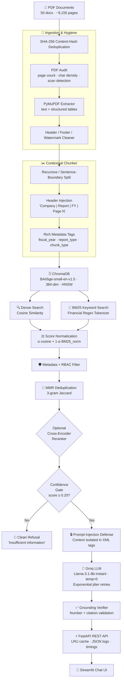

<div align="center">

# 🏦 Finance RAG System

### Production-Grade Retrieval-Augmented Generation for Indian Financial Intelligence

<br/>

[](https://www.python.org/)
[](https://fastapi.tiangolo.com/)
[](https://www.trychroma.com/)
[](./tests/)
[](./data/test_sets/)
[](./LICENSE)
[](https://docs.astral.sh/ruff/)

<br/>

> **33,689 vectors · 50 documents · ~9,155 pages · 15 BSE companies + RBI publications**

<br/>

**[📖 Documentation](#-quickstart) · [🚀 API Reference](#-api-reference) · [📊 Evaluation](#-evaluation-suite) · [🐳 Docker](#-docker)**

</div>

---

## ✨ What Makes This Different

Most RAG demos return wrong answers confidently. This system is built to **refuse gracefully and cite accurately**:

| Problem | Solution Implemented |
|---|---|
| Cross-company data leakage | Metadata-filtered retrieval enforced on both dense + BM25 paths |
| Hallucinated numbers | Deterministic grounding verifier checks every figure against sources |
| "Scanned PDF" silent failures | PDF audit on ingest — fails loudly on near-zero text density |
| Duplicate passages dominating context | MMR 3-gram Jaccard deduplication before LLM call |
| Context-free numeric chunks | Contextual chunk headers: `[Company \| Report \| FY \| Page N]` |
| Low-relevance queries hitting LLM | Pre-LLM confidence gate — refuses before spending inference tokens |
| Dense + sparse score mismatch | Normalized score blending (min-max BM25 + raw cosine, configurable α) |

---

## 🏗️ Architecture



---

## 🚀 Feature Highlights

<table>
<tr>
<td width="50%">

**🔍 Hybrid Retrieval**
- Dense semantic search (BGE-small, 384-dim)
- BM25 with financial regex tokenizer — preserves `6.25%`, `GNPA`, `NDTL`, `FY24`
- Configurable α blend, candidate pool `max(top_k × 8, 40)`
- Persistent BM25 index loaded at startup

**🛡️ Hallucination Guardrails**
- Pre-LLM confidence threshold gate (env `RETRIEVAL_THRESHOLD`)
- Post-LLM deterministic grounding verifier
- Every numeric claim validated against source passages
- Prompt-injection hardened: context isolated in XML delimiters

**🔐 Security & Auth**
- API key authentication with per-key scopes
- Role-based access control (`admin`, `analyst`, `company_restricted`)
- Rate limiting per API key
- CORS restricted to UI origin

</td>
<td width="50%">

**📊 Evaluation Suite**
- 63-question labeled dataset across 9 categories
- `hit@5`, `MRR`, `answer_ok_rate`, `refusal_accuracy`
- Full RAGAS metrics (faithfulness, context precision/recall)
- Pre-push regression gate — CI fails if metrics drop > 3%

**⚡ Performance**
- Sub-second retrieval latency (p50 < 100ms)
- In-process LRU response cache
- Per-stage timing: embed → retrieve → rerank → generate
- Structured JSON logs with request IDs

**🧠 Query Intelligence**
- Automatic entity/year/doc-type detection from natural language
- Metadata filters propagated to both dense + BM25 paths
- MMR deduplication prevents duplicate passages in context
- Optional cross-encoder reranker (fetch 40, rerank, keep 5)

</td>
</tr>
</table>

---

## 📚 Corpus

| Category | Coverage | Documents | Vectors |
|---|---|---|---|
| **BSE Corporate** | TCS · Infosys · Wipro · HCL Tech · Reliance · HDFC Bank · ICICI Bank · SBI · Axis Bank · Bajaj Finance · L&T · Maruti · Asian Paints · Sun Pharma · ITC | 15 Annual Reports (FY 2024) | ~20,000 |
| **RBI Publications** | Annual Reports (2021–25) · Monetary Policy Reports · Financial Stability Reports · Economic Reviews | ~35 publications | ~13,689 |
| **Total** | | **~50 documents · ~9,155 pages** | **33,689** |

---

## 📐 Tech Stack

| Layer | Component | Version | Notes |
|---|---|---|---|
| **Parsing** | PyMuPDF (`fitz`) | 1.24+ | Table reconstruction, vertical-text filter |
| **Embeddings** | `BAAI/bge-small-en-v1.5` | — | 384-dim, local inference, query prefixes |
| **Vector Store** | ChromaDB | 0.5+ | Persistent HNSW, metadata filtering |
| **Sparse Retrieval** | `rank-bm25` | 0.2+ | Financial regex tokenizer, normalized scores |
| **Reranker** | `cross-encoder/ms-marco-MiniLM-L-6-v2` | optional | Configurable via `RERANKER_MODEL` |
| **LLM** | Llama-3.1-8b-instant (Groq) | — | OpenAI-compatible, temp=0, jitter retries |
| **API** | FastAPI + Uvicorn | 0.115 | Threadpool endpoints, LRU cache |
| **UI** | Streamlit | 1.35+ | Real-time chat with citations |
| **Evaluation** | RAGAS + custom scripts | — | 63-question dataset, Groq judge |
| **Linting** | Ruff | 0.17+ | Zero-error policy enforced in CI |

---

## ⚡ Quickstart

### Prerequisites

- Python 3.11+
- [Groq API key](https://console.groq.com) (free tier available)

### 1 · Clone & Install

```bash
git clone https://github.com/preetham789/finance-rag.git
cd finance-rag

python -m venv venv
# Windows:
.\venv\Scripts\activate
# macOS/Linux:
# source venv/bin/activate

pip install -r requirements.txt
pip install -r requirements-dev.txt
```

### 2 · Configure Environment

```bash
cp .env.example .env
```

Edit `.env`:

```env
# Required
GROQ_API_KEY=your_groq_api_key_here
GROQ_MODEL=llama-3.1-8b-instant

# Retrieval tuning
HYBRID_ALPHA=0.7            # 0.0 = pure BM25, 1.0 = pure dense
RETRIEVAL_THRESHOLD=0.20    # pre-LLM confidence gate

# Auth (set to "off" for local dev)
AUTH_MODE=apikey
API_KEYS=dev-key-12345:admin,analyst-key-67890:analyst

# Optional: cross-encoder reranker
# RERANKER_MODEL=cross-encoder/ms-marco-MiniLM-L-6-v2

# Guardrails
GROUNDING_STRICT=false
```

### 3 · Ingest Documents

```bash
# Place PDFs in data/raw/bse/ and data/raw/rbi/
python scripts/ingest.py    # parse + chunk + audit
python scripts/embed.py     # embed + store in ChromaDB
```

### 4 · Launch

```bash
# Start API + UI together
python scripts/start.py

# Or separately:
python scripts/start.py --api   # → http://localhost:8000
python scripts/start.py --ui    # → http://localhost:8501
```

| Endpoint | URL |
|---|---|
| 🌐 Streamlit Chat UI | http://localhost:8501 |
| 📖 Interactive API Docs | http://localhost:8000/docs |
| ❤️ Health & Readiness | http://localhost:8000/health |
| 📊 Corpus Statistics | http://localhost:8000/stats |

---

## 🐳 Docker

```bash
# Build and start both services
docker compose up --build

# API → http://localhost:8000
# UI  → http://localhost:8501
```

`docker-compose.yml` mounts `data/raw/` and `experiments/chromadb/` as named volumes so your index survives container restarts.

---

## 🔌 API Reference

### Health Check

```bash
curl http://localhost:8000/health
```

```json
{
  "status": "ok",
  "ready": true,
  "vectors": 33689,
  "model_loaded": true
}
```

### Query (Hybrid Retrieval)

```bash
curl -X POST http://localhost:8000/query \
  -H "Content-Type: application/json" \
  -H "X-API-Key: dev-key-12345" \
  -d '{
    "question": "What was RBI policy repo rate decision in February 2025?",
    "retrieval_mode": "hybrid",
    "alpha": 0.7,
    "top_k": 5
  }'
```

<details>
<summary><b>Example Response</b></summary>

```json
{
  "question": "What was RBI policy repo rate decision in February 2025?",
  "answer": "The RBI Monetary Policy Committee decided to reduce the policy repo rate by 25 basis points to 6.25 per cent in February 2025 [Source: RBI, Page 112].",
  "sources": [
    {
      "company": "RBI",
      "page_number": 112,
      "source_file": "0ANNUALREPORT202425.pdf",
      "score": 0.892,
      "preview": "[RBI | MONETARY_POLICY | 2025 | Page 112] The Monetary Policy Committee (MPC) at its meeting on February 7, 2025 decided to reduce the policy repo rate...",
      "chunk_id": "0ANNUALREPORT202425_p112_c1"
    }
  ],
  "retrieval_mode": "hybrid",
  "model": "llama-3.1-8b-instant",
  "tokens_used": 1140,
  "latency_ms": 780,
  "grounding": {
    "ok": true,
    "citations_valid": true,
    "numbers_grounded": true
  },
  "timings": {
    "retrieval_ms": 82,
    "llm_ms": 680,
    "grounding_ms": 18
  }
}
```

</details>

### Available Endpoints

| Method | Endpoint | Description | Auth Required |
|---|---|---|---|
| `GET` | `/health` | Readiness + vector count + model status | No |
| `GET` | `/stats` | Corpus breakdown by company and doc type | No |
| `POST` | `/query` | Full RAG query (hybrid/dense/sparse) | Yes |
| `GET` | `/docs` | Interactive Swagger UI | No |

---

## 📊 Evaluation Suite

The system ships with a **63-question labeled dataset** (`src/evaluation/dataset.py`) spanning 9 difficulty categories:

| Category | Questions | Examples |
|---|---|---|
| `single_fact` | 15 | "What is TCS's revenue in FY24?" |
| `numeric` | 12 | "What was RBI's repo rate in Feb 2025?" |
| `comparative` | 8 | "Compare GNPA ratios of HDFC and ICICI" |
| `temporal_trap` | 6 | "What will TCS earn in FY2030?" |
| `out_of_corpus` | 7 | "What is Apple's market cap?" |
| `adversarial` | 5 | Prompt-injection attempts |
| `multi_company` | 5 | Questions spanning 2+ entities |
| `refusal` | 5 | Intentionally unanswerable questions |

### Run Evaluations

```bash
# 1. Deterministic HTTP evaluation (no judge LLM cost)
python scripts/eval_api.py --eval-set data/test_sets/eval_set_v2.jsonl

# 2. Alpha-sweep: find optimal hybrid blend parameter
python scripts/eval_api.py --ab-sweep --alphas 0.3,0.5,0.7,0.9

# 3. Full RAGAS evaluation (faithfulness, context precision/recall)
python scripts/ragas_eval.py --eval-set data/test_sets/eval_set_v2.jsonl

# 4. Latency benchmark (p50, p95, p99 under load)
python scripts/bench_latency.py --concurrency 1,2,4,8 --n 24

# 5. Pre-push regression gate
python scripts/eval_api.py --out data/test_sets/latest.json
python scripts/eval_api.py --compare data/test_sets/baseline.json data/test_sets/latest.json
```

### Metrics Reported

| Metric | Description |
|---|---|
| `hit@5` | Ground-truth (company, page) retrieved in top-5 |
| `MRR` | Mean Reciprocal Rank of correct source |
| `answer_ok_rate` | Expected figures/terms present in generated answer |
| `refusal_accuracy` | Out-of-corpus / temporal-trap queries correctly refused |
| `false_refusal_rate` | Answerable queries wrongly refused (lower is better) |
| `citation_rate` | Factual answers containing verified `[Source: ...]` tags |

---

## 🧪 Testing

```bash
# Full unit test suite (56 tests)
python -m pytest tests/ -v

# Code quality
ruff check src/ tests/ scripts/

# Specific test files
python -m pytest tests/test_loader.py -v      # PDF parsing & dedup
python -m pytest tests/test_chunker.py -v     # Overlap, headers, metadata
python -m pytest tests/test_retriever.py -v   # Scoring math, MMR, filters
python -m pytest tests/test_grounding.py -v   # Number & citation verifier
python -m pytest tests/test_security.py -v    # Auth, RBAC, rate limiting
python -m pytest tests/test_chain.py -v       # Prompt assembly, retries
```

**Coverage**: parsers · chunker overlap & headers · retriever scoring math · grounding verifier · security scopes · query understanding · API serialization

---

## 📁 Project Structure

```
finance-rag/
├── src/
│   ├── api/
│   │   ├── main.py                 # FastAPI app — threadpool endpoints, LRU cache, timings
│   │   └── streamlit_app.py        # Streamlit chat interface with citations
│   ├── ingestion/
│   │   ├── loader.py               # PDF audit, hash dedup, table extractor, cleaner
│   │   ├── chunker.py              # Contextual headers, sentence/token splitting, metadata
│   │   └── embedder.py             # BGE-small embeddings, ChromaDB batch ingestion
│   ├── retrieval/
│   │   └── retriever.py            # Hybrid retrieval, financial tokenizer, MMR, reranker
│   ├── generation/
│   │   └── chain.py                # Prompt-injection defense, Groq retries, grounding call
│   ├── evaluation/
│   │   ├── dataset.py              # 63-question curated multi-category eval dataset
│   │   └── ragas_eval.py           # RAGAS runner (faithfulness, precision, recall)
│   ├── config.py                   # Pydantic settings — all env vars in one place
│   ├── grounding.py                # Deterministic number & citation verifier
│   └── security.py                 # API key auth, RBAC scopes, rate limiting
│
├── scripts/
│   ├── ingest.py                   # PDF → chunks (with audit & dedup)
│   ├── embed.py                    # Chunks → ChromaDB vectors
│   ├── query.py                    # CLI query interface
│   ├── start.py                    # Service launcher (API + UI)
│   ├── purge_source.py             # Remove specific company's vectors
│   ├── eval_api.py                 # Eval runner + α-sweep + regression gate
│   ├── ragas_eval.py               # Full RAGAS evaluation
│   └── bench_latency.py            # Concurrency & latency benchmark
│
├── tests/                          # 56 pytest unit & integration tests
│   ├── test_loader.py
│   ├── test_chunker.py
│   ├── test_retriever.py
│   ├── test_grounding.py
│   ├── test_security.py
│   ├── test_chain.py
│   └── ...
│
├── data/
│   ├── raw/
│   │   ├── bse/                    # 15 BSE annual report PDFs (gitignored)
│   │   └── rbi/                    # ~35 RBI publication PDFs (gitignored)
│   ├── processed/                  # Intermediate chunks (gitignored)
│   └── test_sets/
│       ├── eval_set_v2.jsonl       # 63-question labeled eval dataset
│       └── *.json                  # Evaluation run artifacts
│
├── experiments/
│   └── chromadb/                   # Persistent vector index (gitignored)
│
├── notebooks/                      # Exploratory analysis notebooks
├── social-assets/                  # Architecture diagrams (SVG + PNG)
├── .github/
│   └── workflows/ci.yml            # CI: ruff lint + 56 pytest tests
│
├── Dockerfile
├── docker-compose.yml
├── requirements.txt                # Production dependencies
├── requirements-dev.txt            # Dev & testing dependencies
├── pytest.ini
├── ruff.toml
└── .env.example
```

---

## 🔧 Configuration Reference

All settings are loaded from environment variables via `src/config.py` (Pydantic Settings):

| Variable | Default | Description |
|---|---|---|
| `GROQ_API_KEY` | — | **Required.** Groq API key |
| `GROQ_MODEL` | `llama-3.1-8b-instant` | LLM model ID |
| `HYBRID_ALPHA` | `0.7` | Dense weight (0 = pure BM25, 1 = pure dense) |
| `RETRIEVAL_THRESHOLD` | `0.20` | Pre-LLM confidence gate cutoff |
| `TOP_K` | `5` | Chunks passed to LLM |
| `CHUNK_SIZE` | `1024` | Target tokens per chunk |
| `CHUNK_OVERLAP` | `128` | Token overlap between chunks |
| `AUTH_MODE` | `apikey` | `"apikey"` or `"off"` |
| `API_KEYS` | — | `key:scope,key:scope` pairs |
| `RERANKER_MODEL` | `""` | Cross-encoder model (empty = disabled) |
| `GROUNDING_STRICT` | `false` | Reject response if grounding fails |
| `RAGAS_JUDGE_MODEL` | `llama-3.1-8b-instant` | Judge LLM for RAGAS eval |

---

## 🔒 Security Notes

- **API keys** are never logged — only the key prefix is recorded in access logs
- **Prompt injection** is hardened: retrieved context is isolated in `<context_passages>` XML delimiters with an explicit instruction to ignore embedded commands
- **CORS** is restricted to the configured UI origin in production mode
- **`.env`** is gitignored — use `.env.example` as template
- Run `gitleaks detect` before pushing to scan for accidentally committed secrets

---

## 🤝 Contributing

1. Fork the repository
2. Create your feature branch: `git checkout -b feature/your-feature`
3. Make changes and run: `python -m pytest tests/ -v && ruff check src/ tests/ scripts/`
4. Commit: `git commit -m "feat: your descriptive message"`
5. Push and open a Pull Request

> **CI Gate**: The GitHub Actions workflow runs `ruff check` + `pytest` on every PR. All 56 tests must pass and linting must be clean before merging.

---

## 📄 License

MIT License — see  [LICENSE](./LICENSE) for details.

Designed for financial research, educational purposes, and production RAG reference implementations.

---

<div align="center">

**Built with ❤️ for the Indian financial ecosystem**

*TCS · Infosys · Wipro · HCL · Reliance · HDFC Bank · ICICI Bank · SBI · Axis Bank · Bajaj Finance · L&T · Maruti · Asian Paints · Sun Pharma · ITC · Reserve Bank of India*

</div>
